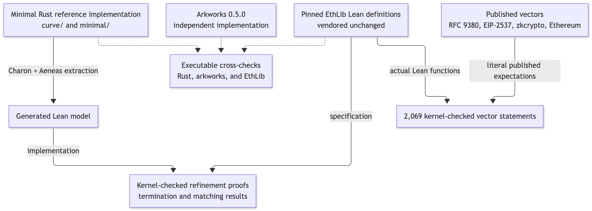

**Disclaimer: This project was mostly conjured by AI and has not been independently reviewed. Treat it as experimental research code.**

# Arkworks → Aeneas → EthLib

BLS12-381 field arithmetic, G1 operations, compressed encoding/decoding, subgroup
checks and pairing-product checks in Rust, extracted through Charon/Aeneas and
proved against a pinned EthLib Lean specification. The Rust manually specializes
arkworks 0.5.0 routines; tests compare outputs and instrumented intermediate states
with the original crate.



Proofs establish termination and agreement with EthLib under each function's
[documented preconditions](docs/proof-coverage.md). Arkworks agreement is tested,
not universally proved. Charon/Aeneas translation and native compilation remain
trusted. The Rust is variable-time research code.

## Examples

- [Different exponentiation algorithms, one proved specification](docs/alternative-exponentiation.md)
- [A small proved optimization](docs/optimization-example.md)
- [Subgroup checks and point validation](docs/subgroup-check.md)
- [Pairing-product example and proof scope](docs/pairing-proof.md)

## Run

Requires Rust, Lean, Python 3.11+, opam and native build tools; see
[setup and reproduction instructions](docs/running.md).

```sh
cargo fetch --locked --manifest-path rust/Cargo.toml
make install-tools
make curve
```

Verification includes **756 curve proof audits**, **2,069 kernel-checked published
vector statements**, native comparisons and instrumented Arkworks trace checks.
Reports and generated Lean are written to ignored `build/` output. GitHub Actions
runs fresh extraction and verification for code changes.

[Proof coverage](docs/proof-coverage.md) · [Arkworks adaptations](docs/arkworks-alignment.md) ·
[Verification audit](docs/migration-audit.md) · [Pinned tools](toolchain.json)

[Apache-2.0](LICENSE). Vendored sources and fixtures retain their
[third-party notices](THIRD_PARTY_NOTICES.md).
